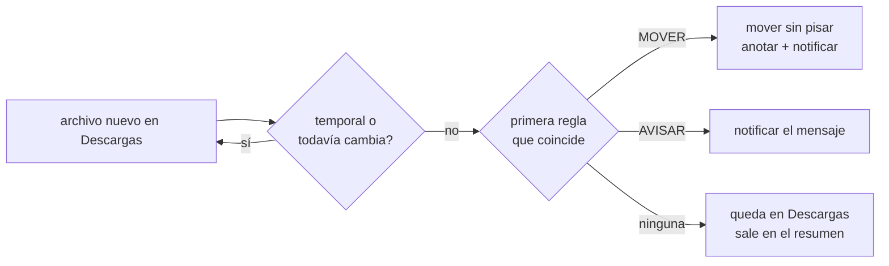

# ORDENADOR — ordenador de Descargas

Servicio de consola para Debian + KDE que vigila `~/Descargas` y manda cada archivo nuevo a su lugar según reglas. **Nunca borra nada**: solo mueve, y lo que vence va a la papelera (`gio trash`), que vaciás vos.

- Espera a que el archivo deje de cambiar (5 s) y no toca temporales (`.part`, `.crdownload`, `.tmp`, ocultos) ni lo que Firefox todavía está bajando.
- Aplica la **primera** regla que coincide. Si el destino ya tiene un archivo con ese nombre, no lo pisa: `nombre (2).ext`.
- Notifica cada movimiento en KDE (`notify-send`) y lo anota para poder deshacerlo.

Lo programaron dos LLM locales (qwen3.5-9b y Gemma 4 E4B) con Claude diseñando y evaluando: ver [`docs/llm/README.md`](docs/llm/README.md) y [`docs/llm/mejoras-qwen.md`](docs/llm/mejoras-qwen.md).

## Reglas por defecto

| regla | si el archivo… | entonces |
|---|---|---|
| `instaladores` | es `.deb`, `.AppImage` o `.exe` | va a `~/Descargas/Instaladores`; a los 30 días, a la papelera |
| `rutinas` | es `rutina-*` o `plan-*` (`.json` o `.pdf`) | va a `~/Documentos/Carpeta personal/Gimnasio` |
| `facultad` | es un PDF con el nombre de una materia (sin distinguir mayúsculas ni acentos) | no se mueve; avisa "Subilo a Drive, carpeta <MATERIA>/teoria" |
| `finanzas` | es PDF/CSV/XLS(X) con "mercado pago", "account statement", "resumen de cuenta", "estado de cuenta" o "extracto" | va a `~/Documentos/Carpeta personal/Finanzas/entrada` |
| `imagenes` | es `png`, `jpg`, `jpeg`, `webp` o `gif` | va a `~/Imágenes` |

Las reglas se editan a mano en `~/.config/ordenador/reglas.json` (se crea con estas la primera vez). Cada regla tiene `nombre`, `accion` (`MOVER` o `AVISAR`), `extensiones`, `patrones` (glob con `*` y `?`), `palabras`, `destino` (con `~`), `mensaje` (con `{palabra}`) y `diasPapelera` (0 = nunca). Las listas vacías no ponen condición; dentro de una lista basta con que coincida un elemento.



## Requisitos
OpenJDK 21, Maven 3.9, `gio` y `notify-send` (vienen con el escritorio).

## Compilar, testear y ejecutar
```bash
mvn package                      # genera target/ordenador.jar (y corre los tests)
mvn test                         # solo los tests
java -jar target/ordenador.jar ayuda
```

Comandos:
| comando | qué hace |
|---|---|
| `vigilar [--simular]` | vigila la carpeta y ordena cada archivo nuevo (lo usa el servicio) |
| `ordenar [--simular]` | ordena una vez lo que ya hay |
| `deshacer` | deshace el último movimiento (se puede repetir) |
| `resumen` | lista lo que quedó sin ordenar y lo notifica (para correr una vez por semana) |
| `limpiar [--simular]` | manda a la papelera lo vencido |

`--simular` no mueve, no anota ni notifica: solo escribe lo que haría.

## Dónde guarda los datos
- Reglas: `$XDG_CONFIG_HOME/ordenador/reglas.json` (o `~/.config/ordenador/reglas.json`). Si el archivo tiene un error, el programa avisa y no lo pisa.
- Registro de movimientos: `$XDG_DATA_HOME/ordenador/movimientos.log` (o `~/.local/share/ordenador/movimientos.log`), una línea `fecha<TAB>origen<TAB>destino` por movimiento.

## Servicio de systemd (de usuario)
```bash
mkdir -p ~/.local/lib/ordenador ~/.config/systemd/user
cp target/ordenador.jar ~/.local/lib/ordenador/
cp systemd/ordenador.service ~/.config/systemd/user/
systemctl --user daemon-reload
systemctl --user enable --now ordenador.service
journalctl --user -u ordenador -f      # lo que va haciendo
```
Para probarlo sin mover nada, en `ExecStart` agregá `--simular` después de `vigilar`.

## Estructura
- `model`: `Regla`, `Config`, `Accion`, `Movimiento`.
- `service`: `Nombres`, `Clasificador`, `ConfigRepo` + `ReglasPorDefecto`, `Rutas`, `Registro`, `Ordenador`, `Papelera`, `Resumen`, `Pendientes`, `Vigilante`.
- `cli`: `Main`, `Argumentos`, `NotifySend`.
